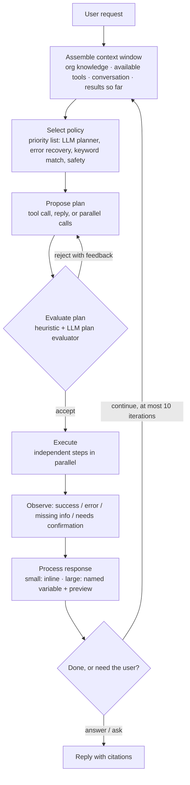
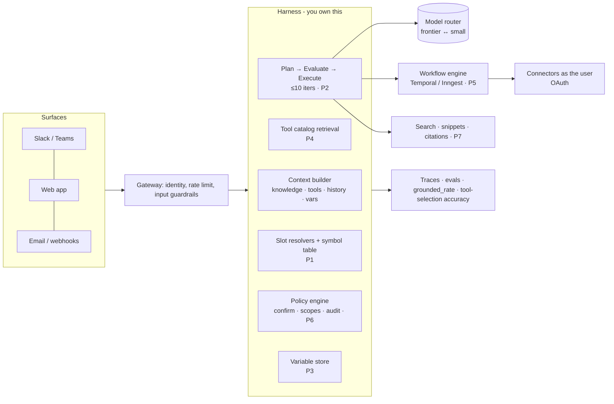

# Moveworks teardown: what to steal, what to skip

> Scope: public information only (moveworks.com, docs.moveworks.com / help.moveworks.com,
> Moveworks blog, ServiceNow investor news), gathered 11 Nov 2026. No logins, no scraping
> behind auth, no proprietary code or assets copied. Every claim is tagged:
>
> - **[Observed]** seen directly on the public site or docs
> - **[Documented]** stated by Moveworks in its docs or blog (vendor claim, not verified)
> - **[Inferred]** my reasoning from the above; could be wrong
>
> REA's live browser capture could not be run for this report: the cloud sandbox's network
> policy blocks moveworks.com. Section 9 is a copy-paste runbook to run REA on your own
> machine and fill the front-end gaps (framework, bundles, endpoints) with hard evidence.

---

## 0. TL;DR: the 8 ideas worth stealing

Moveworks' public material describes one core idea: **the LLM chooses what to do; deterministic
software decides how to do it, and the LLM never handles the dangerous bits (IDs, permissions, writes).**
Everything below follows from that idea.

| # | Pattern | One-line why | Effort to adopt |
|---|---------|--------------|-----------------|
| 1 | **Symbolic slot resolution**: the LLM picks from fetched candidates; it never writes an ID | Removes the most common failure in agentic writes, an invented ID | Low |
| 2 | **Plan → evaluate → execute loop**, capped at 10 iterations, with a priority list of policies | Gives you a stopping point, a self-check step and a fallback | Medium |
| 3 | **Large tool output becomes a variable handle plus a preview** | Keeps the context window small, and attention is what limits quality | Low |
| 4 | **Tool catalog retrieval ("Manifest Generator")** with descriptions rewritten so no two tools look alike | Tool selection breaks down past about 30 to 50 tools; this fixes it | Medium |
| 5 | **Compound actions in a small YAML DSL**: branching, loops and parallel steps run without the LLM | Steps you can test and replay, instead of probabilistic ones | Medium |
| 6 | **Confirm before writes, act as the user (User Consent Auth), leave an audit comment** | Safety and blast radius are enforced by the harness, not the prompt | Low |
| 7 | **Return data in a citation structure; treat "no citation" as an ungrounded answer** | A grounding metric you can compute without an LLM judge | Low |
| 8 | **Docs written for AI readers**: `llms.txt`, a `.md` copy of every page, a docs MCP server | Your docs become usable by your customers' agents | Low |

If you only adopt three, adopt **1, 3 and 6**. They are cheap, model-agnostic, and each one prevents a
category of production incident.

---

## 1. Context: why this company is worth studying (and why it's a moving target)

- Moveworks was founded in 2016 as an IT-support chatbot that ran in Slack and Teams. **[Documented]**
- ServiceNow **completed its acquisition on 15 Dec 2025**. About 250 customers already used both
  products. The stated thesis was an "AI-native front door for work." **[Documented]** (ServiceNow IR)
- The site is now branded "Moveworks by ServiceNow". It promotes **ServiceNow EmployeeWorks**, the closing
  CTA is "Governed AI for every employee", and the Company menu leads with "ServiceNow officially acquires
  Moveworks". **[Observed]**

**First-principles reading:** what ServiceNow bought was not the model. In 2023 Moveworks
trained its own LLM family (MoveLM, 1B to 13B, see section 5), and by 2026 the docs talk about
model-agnostic harnesses instead. The asset that lasted was the **interaction layer and the integration
graph**: who the user is, what they're allowed to do, and which of hundreds of systems can do it.
Picture a toll bridge. The bridge (the model) became a commodity. The value is in owning the
on-ramps (integrations) and the toll booth (identity, permissions, audit).

> **Honest caveat:** after the acquisition, expect the public docs to drift toward ServiceNow's
> platform. Docs URLs already redirect (`help.moveworks.com/agent-studio/...` →
> `docs.moveworks.com/harness/...`), and "Agent Studio" was renamed "Tool Studio". **[Observed]**
> Snapshot what you need.

---

## 2. Website teardown (marketing site)

### 2.1 Tech stack

| Layer | Finding | Confidence |
|-------|---------|------------|
| CMS | **Adobe Experience Manager (AEM)**: asset paths under `/content/dam/…`, `meta-template: homepage`, `meta-content-page-ref` | [Inferred] from URL and meta patterns, which are AEM signatures |
| Media | **Adobe Dynamic Media**: `/adobe/dynamicmedia/deliver/…`, WebP renditions, an MP4 logo wall | [Inferred] |
| Tags | **Google Tag Manager** (container `GTM-5TBMC9K`) and Google site verification | [Observed] |
| Locale routing | `/us/en/...` path prefixes | [Observed] |
| Subdomains | `marketplace.`, `help.`/`docs.`, `community.`, `academy.` (each its own product surface) | [Observed] |
| Front-end JS framework | **Unknown**. Not visible without a live capture. Run section 9 | — |

**Verdict:** this is an enterprise marketing stack. It's built for many authors, many locales and
governance, not for speed of iteration. AEM licenses cost six figures a year. **Do not copy it.** For a new project
the equivalent is a headless CMS (Sanity, Payload, Contentful) with Next.js or Astro, plus an image CDN. The
lesson to keep is the **separation of surfaces**: marketing, marketplace, docs, community and
academy each get a subdomain, so each team ships on its own cadence.

### 2.2 Information architecture

```
Products ─ Platform (Agentic AI, Reasoning Engine, Trust & security)
         ─ AI Assistant · Enterprise Search · Tool Studio · Employee Experience Insights
         ─ AI Agent Marketplace · Integrations · Developer Hub
Solutions ─ by Use case (10)  ×  by Function (IT, HR, Mktg, Sales, Finance, Eng)  ×  by Industry (6)
AI Agent Marketplace (top-level link, promoted to the main nav)
Resources ─ Learn (webinars, events, library) · Read (blog, stories, glossary) · Get help (support, docs, community, academy)
Company   ─ About, Leadership, Partners, Newsroom, Trust, Customers, Careers, Contact
```
**[Observed]**

Patterns to adopt:

1. **The Solutions matrix (use case × function × industry).** One product, about 22 landing pages, each
   ranking for a different buyer search ("ITSM automation", "AI for HR", "AI for healthcare").
   It works like a bond ladder: the same capital (one product) spread across maturities
   (buyer intents), so you catch whatever the market wants. Generate these pages from structured
   content, not one by one.
2. **The marketplace sits in the top nav.** "1000+ AI agents" is a network-effect claim shown on every
   page. If your product has an ecosystem, put it in the nav before it feels big.
3. **Each mega-menu column carries one promo** (a guide, a report, the acquisition news). Every nav hover is an ad slot.

### 2.3 Homepage narrative (the conversion argument, in order)

1. Hero: **"AI that gets work done."** plus a three-step "Easy / Advanced / Wow" ladder.
2. Strategic framing: "One AI front door for work" (now with ServiceNow).
3. Social proof: "Trusted by 350+ organizations" with a logo video wall.
4. How it works: the platform layers.
5. **Interactive quiz, "Find your AI solution", with no email required.**
6. Testimonials (CVS Health, Toyota, BambooHR, Coca-Cola Consolidated, AkzoNobel).
7. Security: FedRAMP, ISO 27001, SOC 2, HIPAA, GDPR.
8. Platform breadth: integrations, marketplace, initiatives, Tool Studio.
9. "Six reasons why…" (objection handling).
10. Analyst recognition (Gartner Visionary 2026, DEX).
11. Content hub, then a closing CTA.
**[Observed]**

This is the **AIDA funnel with an enterprise risk slider**. The first half sells upside (what it does, who
uses it). The second half removes downside (security, analysts, reasons). Enterprise buyers aren't
maximizing return; they're minimizing career risk. In finance terms, the first half sells the
expected return and the second half sells the low volatility.

Steal these:
- **One primary CTA, "Get a demo", repeated 4+ times.** Every other CTA ("Read the report",
  "Watch video") is secondary and leads back to it.
- **The no-email quiz.** Most B2B sites gate content behind a form. Moveworks gives personalized
  value first. That raises engagement, and the quiz answers act as zero-party intent data, which
  [Inferred] probably feeds GTM and personalization.
- **A three-tier capability ladder in the hero** (simple, medium, complex request) shows range in
  five seconds without a feature list.

Critique:
- "AI that gets work done" could be on any of 200 vendor sites. The specificity is in the
  metrics, not the headline.
- The metrics (6M+ employees, 8-week time to value, 10K agents built, 90% deployment) are **unaudited
  vendor claims** with no methodology link. Copy the format, not the habit: link each metric to how it was measured.
- The homepage's `og:type` is `article` [Observed]. A small SEO hygiene slip that shows AEM template reuse.

### 2.4 Docs as a product (the most underrated part)

- `docs.moveworks.com/llms.txt` exists, an index written for LLM crawlers. **[Observed]**
- Pages are served as **`.md` twins** (`…/plugin-critique-checklist.md`). **[Observed]**
- The index advertises a **docs MCP server** at `https://docs.moveworks.com/_mcp/server`. **[Observed]**
- The docs use a **"Golden Rule"** framing and publish a **Plugin Go-Live Checklist**: about 60 concrete review
  rules (see 4.9). **[Observed]**

**Why it matters:** your customers' developers now read docs through their own agents (Claude Code,
Cursor). Docs that are easy for an agent to read are the new SEO. Cost to adopt: an afternoon with
most docs frameworks (Mintlify, Fern and Docusaurus have plugins for this).

---

## 3. Product surface map

```
Access surfaces  : Slack, Teams, web, ServiceNow, email, 100+ languages
Assistants       : Enterprise Assistant (the default), Productivity Assistants (built in Assistant Builder)
Brain            : Agentic Reasoning Engine (v1)  →  Agentic Orchestrator (v2, Controlled Availability)
Tools            : Tool Studio plugins (Conversational & Ambient), MCP Workspace, A2A agents, built-in search
Data             : Enterprise Search over 50+ apps, Entity Catalog, Domains, People Graph
Governance       : guardrails, toxicity filter, AI disclaimers, steerability tools, analytics ("EX Insights")
Ecosystem        : AI Agent Marketplace (1000+), connectors, Academy, Community
```
**[Documented]**

---

## 4. Agent architecture, from first principles

### 4.1 The object model (Tool Studio)

```
Assistant
└── Plugin  ("a tool you own, built on your APIs")
    ├── Conversational Plugin      ← triggered by a user utterance
    │   ├── Natural-language trigger (auto-generated from name + description)
    │   └── Conversational Process
    │       ├── Slots (typed inputs, with resolvers, validation and inference policies)
    │       ├── Activities (action activities, content activities)
    │       ├── Decision policies (if/else control flow)
    │       └── Data bank (slot values + activity outputs)
    └── Ambient Plugin / Agent     ← triggered by a webhook or a schedule
        ├── System Trigger
        ├── Compound Action (multi-step, no user present)
        └── Conversational Process (optional, to notify or ask a user)

Actions:  HTTP · Script · LLM · Built-in · Compound
Compound steps:  action · switch · for · parallel · return · try_catch/raise · notify
Connectors: System · HTTP     Data Types: typed business objects (e.g. JiraIssue)
```
**[Documented]**

Analogy for an SAP person: a **Conversational Process is a transaction code with a
screen flow**, a **Slot is a screen field**, a **Slot Resolver is F4 value help (a search
help)**, a **Compound Action is a BAPI chain run by a workflow**, and a **Data Type is a DDIC
structure**. Moveworks rebuilt the SAP GUI's guardrails for a chat window, with the LLM playing the
user who fills in the screen.

### 4.2 The reasoning loop (Agentic Reasoning Engine)


**[Documented]** (docs: "How the Reasoning Engine Works", "Reasoning Loops")

What each part buys you, from first principles:

| Mechanism | Failure it prevents | Analogy |
|-----------|---------------------|---------|
| **Priority-ordered policy list** (LLM planner plus deterministic fallbacks) | The LLM being the single point of failure. A keyword or safety policy can pre-empt it | Circuit breakers in a trading system: the algorithm trades, but hard limits fire first |
| **Plan evaluator before execution** | Acting on a bad plan. Checking is cheaper than undoing | Compile time vs run time. Catching it before execution is far cheaper |
| **Cap of 10 iterations** | Infinite tool loops and runaway cost | A stop-loss order |
| **Classifying errors by type** ("missing info", "needs confirmation") | Generic retries. Each type routes somewhere different | HTTP status codes: 4xx is the caller's problem, 5xx is the server's |
| **Context rebuilt every turn** | Stale state | A pure function of current state, like React's render |

### 4.3 Context hygiene: "every token competes for the same finite attention"

That quote is from their docs. **[Documented]** The concrete mechanisms:

- **Large structured tool responses are stored as named variables. The model sees only a truncated preview**
  and refers to the variable by name. Later steps (code, DSL, mappers) work on the full data.
- Conversation history has a **24-hour default lookback**. The Reasoning Engine has **no long-term memory**. **[Documented]**
- The newer Orchestrator adds **Skills**: procedure bundles that load **only when the request matches
  their description**. That's lazy loading for instructions.

Physics analogy: attention behaves like a fixed amount of energy spread over every token in
the window. Add 10,000 tokens of JSON and the energy per relevant token drops. Treating it as
"more context is free" is the most common mistake in agent building. Moveworks designed around
the opposite assumption.

### 4.4 Tool selection at scale: the Manifest Generator

The problem: with thousands of plugins, two "Update a PR" tools (GitHub vs Bitbucket) look the
same to a model that sees only a name and a schema. **[Documented]**

Their solution has two phases:
1. **At configuration time**, the system analyzes each plugin (purpose, slots, policies, actions), **asks the
   developer clarifying questions**, and **rewrites descriptions so each one is semantically distinct
   from the other plugins in that environment.**
2. **At request time**, it narrows thousands of plugins to the best subset (a "manifest"), and the
   reasoning engine picks from that small set. **[Documented]**, mechanism partly **[Inferred]**: the
   blog names knowledge graphs, eval datasets, distillation and fine-tuning, but not the retrieval method.

Each tool also gets **positive and negative example utterances**. Native and custom tools compete
on equal terms, and admins resolve overlaps with steerability tools or by disabling one. **[Documented]**

The key insight: **tool descriptions are a shared namespace, and they collide like hash keys.** Writing
each description well in isolation isn't enough. They have to be distinct *relative to each other*.
That's a set-level optimization, and most teams only optimize per tool.

### 4.5 Slot resolvers: the best idea in the stack

> "Slot resolvers exist to make this impossible", referring to an LLM guessing a wrong ID. **[Documented]**

The pipeline:
1. **Candidate retrieval**: run an action (HTTP, script or built-in) that returns real records that
   fit the slot's type.
2. **Disambiguation**: if there are several, show them to the user with citations.
3. **Stable symbolic memory**: the selected record is held in typed working memory and passed to
   actions **without going back through the LLM**, so the model cannot alter the ID.

Rules from the docs: one resolver produces exactly one data type. Use static resolvers (display value
vs raw value) **or** dynamic ones, never mixed. Dynamic resolvers have **no pagination**, so filter at the API. An
inline resolver overrides the type-level one. **[Documented]**

Why this is the right first principle: LLMs are good at **choosing between options shown to them**
(a recognition task) and bad at **producing exact identifiers from memory** (a recall task). Think of
an exam: multiple choice is easier than writing the answer from scratch. Resolvers turn every ID
field into multiple choice.

### 4.6 Deterministic orchestration: Compound Actions and the DSL

- Compound actions are YAML with `steps`, `action` (`action_name`, `output_key`), `switch/cases/default`,
  `for`, `parallel`, `return` (`output_mapper`), `try_catch`, `raise`, and `notify`. **[Documented]**
- The expression DSL uses `$FUNCTIONS`: `data.tickets.$FILTER(t => t.status == "open").$LENGTH()`,
  `$CONCAT([...])`, `$PARSE_TIME(value) >= $TIME()`, `value in ["US","CA"]`. **[Documented]**
- The Data Mapper is YAML with `MAP()`, `CONDITIONAL()`, `LOOKUP()`. Bare values are data-bank
  references, and literals need extra quoting (`'''approved'''`). **[Documented]**
- Their own checklist says: **"Avoid LLM actions in user-facing compound actions"** and "use the lightest
  model for simple LLM tasks, or remove the step." **[Documented]**

The principle: the LLM is the **router**, not the **runtime**. It is a dispatcher that picks the
right train and track, and the train then runs on rails.

Critique: the quoting (`'''approved'''`, `'""'`) is a known trap, and a homemade DSL is a
language you have to maintain forever. For your projects, use **JSONata or CEL (Common Expression
Language)** plus a standard workflow engine (Temporal, Inngest, AWS Step Functions) instead of a
custom DSL.

### 4.7 Safety enforced by the harness, not the prompt

From the harness blog and checklist: **[Documented]**
- "The model reasons, but **the harness is where permissions, guardrails, and human oversight are
  actually enforced**."
- **Require confirmation for create, update and delete actions.**
- **User Consent Auth** (OAuth as the user) where possible. Otherwise, write an **audit comment naming the
  requesting user and time** on every write.
- "**Don't expose capabilities beyond what users can do in the product UI**." In other words, the agent
  is never more powerful than the person using it.
- Make sure empty or null filter values can't bypass permissions. That's a real bug class: `WHERE owner = NULL`
  can mean "all rows" in some API designs.
- Validate inbound webhooks with signatures, and filter events at the source.
- Each agent gets its own identity as a non-human principal for auditing. Rollback to a known-safe state.

Ask how a manager would delegate to an intern: rules in the intern's head ("please don't
delete prod") are a prompt. Taking away the delete permission is the harness.

### 4.8 Grounding and citations

- The assistant is "constrained to answer only from your enterprise data". The steps are input guardrails,
  then search, then RAG over **snippets** (documents split so answers cite the right section), then a
  clarifying question, then "I couldn't find it, want to file a ticket?". **[Documented]**
- **Diagnosis rule: no tool call or no citation means the answer was probably ungrounded.** **[Documented]**
- They list where ungrounded content comes from: acronym expansion from training data, filler from the
  "helpful persona", drafting, tone drift, and "grounded but wrong" (misreading ambiguous sources).
  They claim ungrounded knowledge answers are **under 0.1%** of interactions. **[Documented, unverified]**

Adopt the diagnosis rule as an **automatic metric**: share of factual answers with at least one citation
that resolves to a retrieved snippet. No LLM judge needed, and you can alert on it.

### 4.9 The Go-Live Checklist (encode it as lint rules)

Selected rules worth turning into CI checks for your own agents: **[Documented]**
- At least 5 trigger examples with *different structure*, not just swapped verbs. One intent per plugin.
- Slot descriptions are one sentence (value, format, example). **No prompt engineering in descriptions**:
  logic goes into policies, resolvers and validation rules.
- Don't ask for what you already know (email, name and ID come from the user's session).
- Use inference with an empty fallback for required slots, and inference with an explicit fallback for optional ones.
- Run independent steps in parallel. Merge near-duplicate compound actions behind a parameter.
- Trim outputs to the fields the user needs. Turn API links into links the user can open.
- No two plugins share the same core API action.
- Every branch of a compound action must be reachable and return well-formed output.

These are **static properties of configuration**, so a linter can check them. Most teams leave them as
tribal knowledge.

### 4.10 Version 2: the Agentic Orchestrator (where they are heading)

**[Documented]**, in Controlled Availability, Enterprise Assistant planned for Q1 2027:
- **Instructions** (run on every turn, after a fixed base prompt), **Skills** (lazy-loaded procedures),
  **built-in code execution**, **artifacts** (reports, spreadsheets, decks), file and image understanding.
- **MCP servers, A2A agents, Tool Studio plugins and search all run in one loop.**
- **Multi-step work goes through a plan the user approves**, and the session suspends while it waits.
- **MCP Workspace**: Moveworks acts as an *MCP client*. Admins review each server's tools, set user
  access and a tool approval policy. Their own guidance: MCP suits "bounded, transactional" work, and
  mission-critical multi-step flows still belong in plugins.

**[Inferred] reading:** v1 was "constrain the model hard because models were weak (2023–24)". v2
is "relax the constraints and add tools because models got strong (2025–26)". This is the same
arc as Claude Code, Codex and others. **Design lesson: keep the constraints (resolvers, confirmation,
auth) in the harness and loosen the orchestration as models improve.** The safety layer is the
foundation. The orchestration layer is scaffolding that comes down over time.

---

## 5. The model story: a cautionary tale

MoveLM (Oct 2023): **[Documented]**
- A 1B, 3B, 7B and 13B family fine-tuned from Llama 2 and CodeLlama. Three-phase SFT (public data →
  synthetic data for core tasks → explanation tuning with chain of thought).
- About 1.2M examples, built from six years of data: 500M+ tickets, 14M conversations, 400K+ KB articles, 35K forms.
- 8× A100 40GB with DeepSpeed ZeRO-3, about 3 days per 7B run.
- Their own benchmark: function-call accuracy **77% vs 55% for GPT-3.5 Turbo**. Judged by their own annotators.
- Models routed by task difficulty.

**Honest critique:** a 7B fine-tune beating GPT-3.5 on in-house tests was a real result in 2023,
and a depreciating one. Within about 18 months frontier models passed it on general reasoning,
and the 2026 docs talk about model-agnostic harnesses, not MoveLM. A fine-tuned model behaves like an
option with fast **theta decay**: it loses value every month a frontier lab ships.
What *kept* its value: **the eval datasets, the task taxonomy (intent, entity typing, slot filling,
function calling), and the routing-by-difficulty idea.**

**For your projects:** don't fine-tune first. Build the **eval set** first (it's a lasting asset), use
frontier models through an abstraction, and route cheap tasks (classification, extraction) to small or
fast models. Fine-tune only when evals prove a gap you can't close with prompting and retrieval, and
when latency or cost at your volume justifies it.

---

## 6. Adoptable patterns with implementation sketches

These are TypeScript-flavoured sketches. They are framework-agnostic and work with the Claude API tool use,
the Agent SDK, LangGraph or your own loop.

### P1. Symbolic slot resolution (do this first)

```ts
type Candidate<T> = { handle: string; display: string; citation?: string; record: T };

// The resolver runs deterministic retrieval. The LLM only ever sees handles and display text.
async function resolveSlot<T>(slot: SlotDef<T>, userText: string, ctx: Ctx) {
  const candidates = await slot.retrieve(userText, ctx.user); // API call AS the user
  if (candidates.length === 0) return { kind: "ask", prompt: slot.notFoundPrompt };
  if (candidates.length === 1) return bind(slot, candidates[0], ctx);
  // Disambiguation: LLM (or user) picks a handle like "c2". It never sees or emits the raw ID.
  return { kind: "choose", options: candidates.map(c => ({ handle: c.handle, label: c.display })) };
}

function bind<T>(slot: SlotDef<T>, c: Candidate<T>, ctx: Ctx) {
  ctx.symbolTable.set(slot.name, c.record);   // stable memory, outside the context window
  return { kind: "bound", summary: c.display };
}
// Later, the action reads ctx.symbolTable.get("ticket").sys_id. The LLM is not in this path.
```
Test: an eval where the model is shown 3 near-identical tickets and must update one. The share of
writes that hit the wrong record should be 0, and it's 0 *by construction*.

### P2. Bounded plan → evaluate → execute loop

```ts
const MAX_ITERS = 10;
for (let i = 0; i < MAX_ITERS; i++) {
  const policy = policies.find(p => p.applies(state));          // safety → keyword → error-recovery → LLM
  let plan = await policy.propose(state);
  for (let r = 0; r < 2 && !(await evaluate(plan, state)).ok; r++)
    plan = await policy.propose(state, /*feedback*/);
  const results = await Promise.all(plan.independentSteps.map(execute));
  state = record(state, results.map(processResponse));          // P3 happens here
  if (results.some(r => r.kind === "needs_confirmation" || r.kind === "missing_info")) return askUser(state);
  if (plan.isFinalAnswer) return reply(state);
}
return reply(state, { note: "partial: iteration budget exhausted" });
```

### P3. Variable handles for large outputs

```ts
const PREVIEW_CHARS = 2_000;
function processResponse(r: ToolResult): ContextEntry {
  const s = JSON.stringify(r.data);
  if (s.length <= PREVIEW_CHARS) return { inline: r.data };
  const name = `$res_${r.tool}_${nanoid(4)}`;
  vars.set(name, r.data);                                        // full data, outside the prompt
  return { variable: name, shape: schemaOf(r.data), count: lengthOf(r.data), preview: s.slice(0, PREVIEW_CHARS) };
}
// Give the model a tool like `query_variable(name, jsonata_expr)` or code execution to work on the full data.
```

### P4. Tool catalog retrieval and description deconfliction

1. Index each tool: name, description, positive and negative utterances, and data types touched.
2. At request time, run hybrid retrieval (BM25 + embeddings), take the **top 15–25** tools, and pass only those.
3. **Offline deconfliction job:** embed every description, find pairs with cosine similarity > 0.85,
   and have an LLM rewrite both *in contrast to each other*. Add the other tool's utterances as negatives.
   Run it in CI whenever a tool is added.
4. Eval: tool-selection accuracy on a labelled set of utterances. Track it per release.

### P5. LLM routes, the workflow engine runs

- Any multi-step write becomes **one** tool that the LLM calls once with resolved slots. The steps inside
  run in a durable workflow engine (Temporal, Inngest, Step Functions) with retries and `try/catch`.
- Expressions use **CEL** or **JSONata** (both are well specified and have libraries), not a homemade DSL.
- Rule: no LLM call inside a user-facing workflow unless removing it measurably hurts an eval.

### P6. Harness-enforced safety

```ts
const tool = defineTool({
  name: "servicenow_update_incident",
  effect: "write",                   // read | write | destructive → confirmation policy derives from this
  auth: "user_oauth",                // act as the user; fall back to service account + audit stamp
  scopes: ["incident:write"],
  auditStamp: (u) => `Updated via assistant on behalf of ${u.email} at ${new Date().toISOString()}`,
  guard: (args) => assert(args.filter && Object.values(args.filter).every(v => v != null)), // null-filter bypass
});
```
The harness, not the prompt, inserts a confirmation turn for every `write` or `destructive` effect.

### P7. Citation-structured returns

Every retrieval tool returns `{ results: [{ id, title, url, snippet }] }`, and the response renderer
requires `[n]` markers that point to those IDs. Metric: `grounded_rate = answers_with_valid_citation /
factual_answers`. Alert if it drops.

### P8. Go-live linter

Write the checklist in 4.9 as a script that loads your tool and agent configs and fails CI on:
fewer than 5 trigger examples, examples too similar to each other (embedding similarity > 0.9), a
description that contains "if"/"must"/"always" (logic belongs in policy), duplicate API actions across tools,
unreachable workflow branches, and write tools without `confirm`.

### P9. Docs for agents

Ship `/llms.txt`, a `.md` twin for every page, and (optionally) a read-only docs MCP server. Add a
"Golden Rule" page: the three to five rules a builder must never break.

### P10. Marketing-site patterns

A structured solutions matrix (use case × function × industry), the marketplace in the top nav, one primary
CTA, a no-email quiz, a three-tier capability ladder in the hero, and a risk-reduction section
(security, analysts, objections) below the fold. Every metric links to its methodology.

### P11. Ambient agents

Webhook and schedule triggers that run a compound action and *optionally* open a conversation
("Your laptop warranty expires Friday. Want me to order a replacement?"). Verify signatures and filter events
at the source. This is where agents stop being chatbots and start being colleagues.

---

## 7. What NOT to copy

| Thing | Why not |
|-------|---------|
| AEM and Dynamic Media | Enterprise cost and complexity. Use a headless CMS, Next.js or Astro, and an image CDN |
| A homemade YAML DSL with `'''literal'''` quoting | It's a language you'll maintain forever. Use CEL or JSONata |
| Training your own model before you have evals | MoveLM's advantage decayed in about 18 months. Evals and data lasted |
| Unaudited headline metrics | Fine for a market leader with logos. For a newcomer, they cost credibility |
| A 24-hour memory window as the only memory | Fine for IT tickets. Wrong for long-running projects. Pick memory scope per domain |
| Dynamic resolvers with no pagination | Works only when the API can filter well. Design for top-k search instead |

---

## 8. Reference blueprint for your next agentic product



**30 / 60 / 90 days**
- **30:** P1 + P3 + P6 in a single-domain agent (for example SAP or ServiceNow tickets) with 5–10 tools. Build
  an eval set of 100 real utterances with expected tool, args and outcome.
- **60:** P2 loop with evaluator, P7 citations and the grounded_rate dashboard, P8 linter in CI.
- **90:** P4 catalog retrieval once you pass about 30 tools, P11 ambient triggers, P9 docs for agents. Revisit
  fine-tuning only if the evals show a gap.

---

## 9. Runbook: finish the front-end teardown with REA on your machine

The sandbox couldn't reach moveworks.com. On your own machine (public pages only, no login):

```bash
# 1. Install REA
npm install --global rea-agents      # or: npx -y rea-agents@latest <command>

# 2. Start an isolated Chrome profile with a loopback debugging port
google-chrome --remote-debugging-port=9222 --user-data-dir=/tmp/rea-mw \
  --password-store=basic https://www.moveworks.com/us/en

# 3. Find the target and capture the page (DOM, a11y, scripts, resources, network metadata)
rea list-browser-targets http://127.0.0.1:9222 --json
rea inspect-web-page http://127.0.0.1:9222 <TARGET_ID> \
  --observation-ms 5000 --include-script-sources --include-json-body-shapes --json > mw-home.json

# 4. Static bundle analysis: chunk graph, vendor fingerprints (React/Vue/jQuery…), route and endpoint candidates
rea analyze-web-bundle http://127.0.0.1:9222 <TARGET_ID> --json > mw-bundle.json

# 5. Export the scripts and run the JS application analyzer on them
rea export-web-scripts "$PWD/mw-home.json" "$PWD/mw-scripts" --json
rea analyze-javascript-application "$PWD/mw-scripts/files" --json > mw-js.json

# 6. Watch the "Find your AI solution" quiz while you click through it (SPA navigation, XHR endpoints)
rea observe-web-session http://127.0.0.1:9222 <TARGET_ID> --observation-ms 30000 --json > mw-quiz.json

# 7. Repeat 3–4 on docs.moveworks.com and marketplace.moveworks.com (likely a different stack)
```

Questions the runbook will answer, which this report marks **Unknown** or **[Inferred]**:
1. Front-end framework on www (AEM HTL with vanilla JS? React islands?).
2. Docs platform (the `.md` twins and `llms.txt` suggest a modern docs SaaS such as ReadMe, Mintlify or Fern).
3. Marketplace stack, and whether it calls a public catalog API.
4. Quiz logic: client-side decision tree or a server call.
5. Third-party tags beyond GTM (Marketo/6sense/Drift-style B2B intent tooling is typical).

Paste the JSON outputs back into this thread and I'll fold them into section 2.1 with evidence.

---

## 10. Check your understanding (do these, don't just read)

1. **Slot resolver.** A user says "close my VPN ticket". They have 3 open tickets, 2 of them about VPN.
   Walk through exactly what the resolver, the LLM and the action each see and do. Where could
   a wrong ID still sneak in? (Hint: a resolver that returns "exact value" when it should return a "list".)
2. **Context budget.** A tool returns 4,000 Jira issues (about 1.2M tokens). Design the P3 handling so
   the model can answer "how many P1s were opened last week by the EMEA team?" without the issues ever
   entering the prompt. Which tool do you expose to the model?
3. **Tool collision.** You have `create_ticket_servicenow` and `create_ticket_jira`. Write one
   description and 3 negative examples for each so a planner can't confuse them. Then name the *user
   context* signal that should decide the choice before the LLM is involved at all.
4. **Critique.** Moveworks says ungrounded answers are under 0.1%. Design a measurement that would *falsify*
   that claim on your own system. What's the denominator, and how do you sample?
5. **Strategy.** In 2023 Moveworks bet on its own 7B model. Make the strongest case that this
   bet was *correct* for them at the time, even though it depreciated. (Think in options pricing: what
   did the bet buy them besides the model?)

---

## Sources

- Moveworks homepage: https://www.moveworks.com/
- How the Reasoning Engine Works: https://docs.moveworks.com/harness/agentic-reasoning-engine/how-the-reasoning-engine-works
- Reasoning Loops: https://docs.moveworks.com/harness/agentic-reasoning-engine/reasoning-loops
- Plugin Selection: https://docs.moveworks.com/agent-studio/agentic-ai/agentic-reasoning-engine/reasoning-loops/plugin-selection
- Assistants, agents, plugins: https://docs.moveworks.com/agent-studio/core-concepts/assistants-agents-plugins
- Conversation Process: https://docs.moveworks.com/agent-studio/conversation-process
- Slot Resolvers: https://docs.moveworks.com/agent-studio/core-concepts/agentic-automation-engine/slot-resolvers.md
- Common DSL / Mapper Patterns: https://docs.moveworks.com/agent-studio/configuration-languages/common-dsl-mapper-patterns.md
- Plugin Go-Live Checklist: https://docs.moveworks.com/agent-studio/development-and-testing/plugin-critique-checklist.md
- Grounding and Hallucinations: https://docs.moveworks.com/harness/agentic-reasoning-engine/grounding-and-hallucinations
- Agentic Orchestrator: https://docs.moveworks.com/harness/agentic-orchestrator
- MCP Workspace: https://docs.moveworks.com/tool-studio/mcp-workspace/overview
- llms.txt: https://docs.moveworks.com/llms.txt
- Blog, Manifest Generator: https://www.moveworks.com/us/en/resources/blog/how-manifest-generator-selects-automations
- Blog, What is an agentic harness: https://www.moveworks.com/us/en/resources/blog/what-is-an-agentic-harness-enterprise-ai-control
- Blog, Introducing MoveLM: https://www.moveworks.com/us/en/resources/blog/introducing-moveworks-llm-movelm
- Blog, Multilingual platform: https://www.moveworks.com/us/en/resources/blog/how-moveworks-built-multilingual-ai-platform
- ServiceNow completes acquisition of Moveworks (15 Dec 2025): https://investor.servicenow.com/news/news-details/2025/ServiceNow-completes-acquisition-of-Moveworks/
